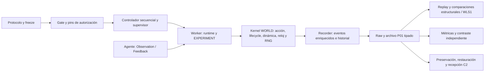

# P01 Research Cycle Closure & Multidisciplinary Assessment

**Síntesis retrospectiva, no nueva fase experimental.** Base `5cdceeedb08b5e8a4f00d284cce499a459aa8c06`, main posterior al PR #44, 2026-11-17 (America/Guayaquil). La orden actual no autoriza experimentos, cambios normativos ni infraestructura. Las diez perspectivas siguientes son análisis metodológicos de Codex; no representan participación de diez especialistas, revisión por pares ni aval institucional.

## 1. Conclusión ejecutiva y disciplina de evidencia

WORLD-LAB demostró históricamente una capacidad experimental **acotada a P01**: configurar un mundo determinista, ejecutar cuatro políticas, archivar resultados tipados, restaurarlos, reproducir transiciones y obtener métricas concordantes con una comparación preregistrada. No se demostró una plataforma universal, interoperabilidad entre motores, aprendizaje online o un crecimiento compuesto de productividad tecnológica. [CL01–CL08, CL19, CL25–CL31](P01_EVIDENCE_MATRIX.md).

En P01, FrontierMemory-v1 obtuvo más consumos que Random en las 32 semillas fijadas: media D=11,125 y 32 victorias; E3 PASS, E4 PASS y aceptación E5 dentro de P01. La condición de preservación C2 quedó resuelta por la confirmación del propietario de descarga y hashes locales Windows: **VERIFIED_EXTERNAL_BACKUP solo para esa copia recibida**. OneDrive sigue NOT_VERIFIED; F6-N, conformidad global e interoperabilidad independiente siguen NOT_ESTABLISHED. La integración de C2 por PR #44 resuelve la revisión pendiente que figuraba en su corte documental original; no se modifica aquel archivo. [CL04–CL08, CL19, CL27](P01_EVIDENCE_MATRIX.md).

**Hecho** es un registro observable; **conclusión científica** aplica una regla inferencial al hecho; **interpretación disciplinaria** usa conceptos para comprenderlo; **juicio de ingeniería** evalúa adecuación/compromisos; **recomendación de gestión** propone una acción condicionada. Las afirmaciones CLxx de la [matriz](P01_EVIDENCE_MATRIX.md) identifican fuente, revisión, método, límite y estado. Aquí las ejecuciones pasadas son DOCUMENTED: no se elevaron por repetir sus informes. Las comprobaciones nuevas DEMONSTRATED son lecturas/hash/continuidad de código, consistencia documental y disponibilidad de archivos, no otra evaluación.

## 2. Identidad, hipótesis y configuración

Experimento `p01-final-20261113-01`; Freeze ID `47155590f10358f6130a1f7eae261ec9ec1fc8035652c04dd23fcc9f92c63e7d`. Protocolo [S01](../F6-A-pilot-protocol.md), SHA-256 `74491ffdf9dbbafa260e53cc21dbb63424e0785d930653e11301d911d119146c`; fuentes ejecutadas en `6fcc698681514a90e1dcd28a0f926967b2304884`, código de preparación congelado `a2c989b67ee447cdeb4733b07f5f6b5887c27ed6`, baseline de motor `59bd859bf102be546f3dfb3bb0200fde0b90233b`. No se sustituye un commit por «latest».

La pregunta fue si FrontierMemory-v1 obtiene una media de consumos mayor que Random en la **batería finita**. C cuenta RecordedEvent `source=action`, `type=RESOURCE_CONSUMED`; D(seed)=C(FrontierMemory)−C(Random). H+ se sostiene si suma D>0 después de satisfacer los criterios técnicos. Rule y Wait son controles descriptivos; no otras hipótesis confirmatorias. Las dos repeticiones comprueban determinismo, no duplican n=32. [CL01/04/05/17/29](P01_EVIDENCE_MATRIX.md).

| Parámetro congelado | Valor |
|---|---|
| Mapa / topología / observación | 12×12, BOUNDED, radio1 |
| Densidades obstáculo/recurso/peligro | 0,15 / 0,12 / 0 |
| Energía inicial / umbral de muerte | 240 / 0 |
| Coste MOVE / WAIT | 1 / 1 |
| Efecto de recurso / daño / regeneración | 8 / 0 / 0 |
| Horizonte | 160 ticks |
| Feedback | Los cuatro flags true |
| Semillas / agentes / repeticiones | 1001–1032; wait, random, rule, frontier_memory_v1; 1 y 2 |

Las semillas del mundo y del agente se derivan mediante namespaces distintos; el mundo inicial es común por semilla. No se entrenó o ajustó la política con la batería final. Regeneración0 hace pertinente recordar consumos; Observation no revela el stock. La energía inicial supera el coste máximo de 160 acciones de coste1: bajo la contabilidad implementada y sin hazards, la supervivencia no es el reto discriminante del perfil (INFERRED de S01/C01), no una conclusión sobre todos los mundos.

## 3. Cronología técnica y genealogía de evidencia

| Hito y revisión pertinente | Qué cambió o se observó | Lo que no acredita |
|---|---|---|
| F6-A, protocolo `0ae7b8e…` | Pregunta, métrica, dominio, controles y reglas de fallo definidos | Encabezado PROPOSED del documento no es estado actual; se conserva por hash |
| F6-B, código `95e918f…`, S12 | FrontierMemory, supervisor, transporte y métricas; 35 pruebas y 32 smoke finales reportados; hubo smoke previo fallido en cierre de manifiesto, conservado | Desarrollo no es la batería final ni n adicional de evaluación |
| F6-E, código `a2c989b…`, manifiesto `61b6e593…`, S13 | Dependencias del perfil de desarrollo identificadas; archive/metrics refijados, 32 nuevos smoke con payloads concordantes; firma/pins como puerta | No bastaba cambiar un booleano ni reutilizar aprobación de otro hash |
| F6-F, `9c5ee8c…`, S14 | Conservación incremental y oráculo separado; recuperación/fixtures de desarrollo | Copia local no era respaldo independiente; oráculo no ejecuta replay |
| E3, 2026-11-14 13:39:18–14:45:22 −05:00, S03 | 256 episodios finales, 0 fallidos; archivo y replay del controlador | Una trayectoria verificada no es otro estudio independiente |
| C1, `33d0c9d…`, PR #41 | Informes originales y manifiestos publicados íntegros | Publicar documentos no transfiere por sí mismo todos los datos |
| E4, 2026-11-14 19:45:25–20:23:18 −05:00, `25fec768…`, PR #42 | Restauración, recuento separado y 256 replay desde archivos restaurados | Mismo motor; no R2 de otro laboratorio ni R4 |
| E5, `13bee0ec…`, PR #43 | Aceptación técnica/científica en P01; liberación retenida por C2 | No conformidad global ni victoria general del algoritmo |
| Transferencia `72f1640d…` / registro `72b97e29…` | Releases bloqueado; rama Git exclusiva; cuatro archivos recuperados con HTTP200 y clone | Retención de objetos Git no tiene garantía de borrado/permanencia universal |
| C2, `3c0241a6…`, PR #44, 2026-11-17 | Propietario informa descarga y SHA local Windows; cierre documental | No inspección independiente del receptor, sincronización OneDrive ni redundancia permanente |

Fechas de E3/E4 convertidas de sus timestamps UTC a America/Guayaquil. Conteos históricos de pruebas no se suman entre suites que se solapan. E3, auditoría, E4 y E5 remiten a un único conjunto final de 256 episodios; no cuatro conjuntos de observaciones.

## 4. Arquitectura efectivamente ejecutada

[C01–C24](P01_EVIDENCE_MATRIX.md): WORLD produce eventos crudos y no consulta al agente. El kernel prepara transición, incrementa reloj/sincroniza RNG y puede restaurar WORLD/RNG; EXPERIMENT coordina observación/feedback/decisión/registro. Recorder es dueño del enriquecimiento `tick/source/sequence` y de copias del historial. **EXPERIMENT no ofrece una transacción conjunta con Recorder**: tras confirmar WORLD, un fallo de registro se propaga fail-stop. Replay tiene su propio checkpoint y rollback de ambos. No se confunden esas garantías.

El runtime carga scripts clásicos enumerados en index.html dentro de una VM y adapta Map entre realms; no es un grafo de paquetes independiente ni un sandbox de seguridad universal. El supervisor usa procesos separados, límite temporal de 30s y heap V8 512MiB por worker; esto no equivale a cap de RSS. El retorno bruto se guarda antes de archivo/validación/replay. El contenedor gzip/JSON etiquetado preserva Map, BigInt y bytes; WLS1 es otra representación binaria canónica para estados. Los SHA-256 de archivos y el FNV-1a de estado tienen propósitos distintos.

## 5. Resultado, activos y alcance observado

| Evidencia histórica | Resultado |
|---|---|
| E3 | 256 completos, 0 fallidos, 256 COMPLETE_MATCH; 519 archivos fuente/copia coincidentes |
| Preservación | 774 objetos, 256 índices, 255 versiones normales de log, 0 conflictos bloqueantes |
| E4 | 256 replay MATCH, 41.216 estados, 82.432 contrastes de bytes; 128 parejas repetidas y 32 mundos comunes |
| Métricas | 32 pares elegibles, 0 exclusiones; suma D=356, media=11,125, mediana=11, min=5, max=20, 32/0/0 victorias/empates/derrotas |
| Medias de consumos | FrontierMemory 14,46875; Random 3,34375; Rule 0,34375; Wait 0 |
| Aceptación y preservación externa | E5 acotado conservado; C2 VERIFIED_EXTERNAL_BACKUP según comunicación local del propietario |

Los datos completos y tabla de 32 semillas se conservan en [S06](../p01-e4/independent-metrics.json), [S07](../p01-e4/independent-descriptors.json) y [S25](../p01-e4/paired-results.csv); no se duplican aquí. La [matriz de capacidades](P01_EVIDENCE_MATRIX.md) distingue diseño, implementación, verificación histórica y reutilización. Este informe no reabre los resultados.

## 6. Referencias conceptuales y uso responsable

**M1.** National Academies of Sciences, Engineering, and Medicine (2019), *Reproducibility and Replicability in Science*, DOI [10.17226/25303](https://doi.org/10.17226/25303). Orienta la distinción entre repetir cálculos con datos/código y realizar otro estudio con datos nuevos.
**M2.** Wilkinson et al. (2016), *The FAIR Guiding Principles for scientific data management and stewardship*, *Scientific Data* 3:160018, DOI [10.1038/sdata.2016.18](https://doi.org/10.1038/sdata.2016.18); [GO FAIR](https://www.go-fair.org/fair-principles/). FAIR significa encontrable, accesible, interoperable y reutilizable: publicar un hash no satisface las cuatro dimensiones.
**M3.** ACM, [Artifact Review and Badging](https://www.acm.org/publications/policies/artifact-review-and-badging-current). Orienta separar disponibilidad del artefacto, evaluación de su funcionamiento y validación de resultados. No se solicita ni se atribuye ningún badge.
**M4.** Cormen, Leiserson, Rivest y Stein (2022), *Introduction to Algorithms*, 4.ª edición, MIT Press, ISBN 9780262046305: BFS y análisis en modelo de grafos/comparación; no una garantía del runtime JavaScript.

Limitación de consulta: los accesos oficiales M1/M2/M3 intentados en esta tarea devolvieron CONNECT 403 del proxy. Se citan como referencias bibliográficas y definiciones orientadoras conocidas, **sin afirmar consulta íntegra actual ni cumplimiento de sus marcos**. M4 es referencia conceptual, no texto inspeccionado en esta tarea. Las conclusiones factuales sobre P01 provienen de las fuentes internas identificadas, no de una supuesta aprobación de esas instituciones. La validación literal de versiones/textos externos queda para una revisión con acceso; no se amplió la red por esta orden.

## 7. Evaluación disciplinaria D1–D10

### D1. Computación y teoría de algoritmos

1. **Objeto:** política FrontierMemory, transición determinista y representación de sus estados.
2. **Ontología:** vértice=celda conocida transitable; arista=adyacencia cardinal; estado del agente=mapa, visitadas y consumidos; estado físico=WORLD/RNG. La trayectoria es una secuencia finita, no el conjunto de todas las ejecuciones posibles.
3. **Pregunta:** ¿la implementación leída corresponde a la política y qué trabajo exige por decisión?
4. **Método:** inspección de reset/step, orden de vecinos/desempates y análisis de bucles según M4; separar inferencia asintótica de medición.
5. **Evidencia:** CL10/13/14, C07 y pruebas históricas de S12.
6. **Diagnóstico:** BFS recorre el grafo conocido; memoria evita tratar consumos conocidos como objetivos nuevos. En modelo de diccionarios habitual, su recorrido cuesta O(V+E), E≤4V; ordenar K candidatos añade trabajo, modelable O(K log K) con un ordenamiento de comparación adecuado. **Array.sort no da una garantía normativa de esa cota**, ni hay benchmark específico de step. Determinismo de rutas no demuestra optimalidad global de recolección bajo observación parcial.
7. **Limitación:** sin prueba formal de corrección de todo el agente ni competición contra todas las políticas. El coste de registrar/reproducir no pertenece solo a BFS.
8. **Riesgo/oportunidad:** optimizar BFS por intuición puede desplazar tiempo de estudiar una pregunta relevante sin identificar el cuello de botella.
9. **Implicación I+D:** medir separadamente decisión/motor/registro antes de cambiar algoritmos (REC-04).
10. **Incertidumbre:** distribución de V/K por episodio, coste de step aislado y comportamiento fuera del perfil.

### D2. Ingeniería de software

1. **Objeto:** fronteras WORLD–EXPERIMENT–Recorder–agente y la carga operacional.
2. **Ontología:** contrato=obligación de interfaz; acoplamiento=dependencia que propaga cambios; activo reutilizable=pieza que puede usarse con identidad y dominio definidos; deuda técnica=compromiso que añade coste/riesgo futuro, no cualquier código viejo.
3. **Pregunta:** ¿qué se reutilizó de verdad y dónde cuesta adaptar?
4. **Método:** seguir productores/consumidores y dos recorridos reales, desarrollo→evaluación y archivo→restauración, sin proponer arquitectura universal.
5. **Evidencia:** CL11/16/21/22, C03/C11/C12/C21, S13.
6. **Diagnóstico:** archiveFor(profile) y el supervisor se reutilizaron; la habilitación final exigió refijar archive/metrics. El listado de scripts de index.html y los globals de VM son una dependencia real del ejecutor, aunque la lógica física esté separada del agente. Los helpers absolutos y Git histórico limitan portabilidad del procedimiento, no invalidan la ejecución observada.
7. **Limitación:** mantenibilidad y coste de cambio entre ciclos distintos no se midieron longitudinalmente. Las interfaces legibles no prueban independencia de implementación.
8. **Riesgo/oportunidad:** un framework general precoz ampliaría superficie de soporte; conservar rutas rígidas aumenta trabajo manual al transferir. Son compromisos, no fallos P0 demostrados.
9. **Implicación I+D:** primero resolver las adaptaciones mínimas documentadas y mantener el núcleo congelado (REC-01/02); modularizar solo ante un consumidor concreto.
10. **Incertidumbre:** cambios necesarios en un segundo protocolo y coste real de mantenimiento por interfaz.

### D3. Métodos formales y verificación

1. **Objeto:** relación entre norma, invariantes, código, pruebas y aceptación.
2. **Ontología:** invariante=propiedad que debe preservarse; obligación de prueba=condición a justificar; test=caso finito; conformidad=relación con una revisión normativa completa, no sinónimo de replay.
3. **Pregunta:** ¿qué propiedades están apoyadas y cuáles no pueden declararse cerradas?
4. **Método:** lectura selectiva de §0/§35, D-01 y pendientes G00; contrastar garantías locales de rollback y validadores sin ejecutar un corpus nuevo.
5. **Evidencia:** CL11/12/19/23, S17–S20, C02/C04/C05.
6. **Diagnóstico:** aserciones y pruebas históricas proporcionan evidencia de preservación en casos ejecutados; el replay contrasta transiciones concretas. Una regla FROZEN puede seguir UNTESTED. Las referencias heredadas incompletas impiden elevar P01 PASS a conformidad global.
7. **Limitación:** sin demostración exhaustiva, análisis universal de data flow, modelo de amenazas amplio o implementación alternativa.
8. **Riesgo/oportunidad:** sustituir requisitos ausentes por código o por una expectativa que hace pasar tests generaría autoridad circular; exigir conformidad global para cada lectura de archivo también paralizaría trabajo independiente útil.
9. **Implicación I+D:** mantener F6-N separado y resolver fuentes concretas cuando una declaración normativa lo requiera (REC-05).
10. **Incertidumbre:** contenido auténtico pendiente y suficiencia de un futuro perfil aprobado; no se reconstruye aquí.

### D4. Investigación experimental

1. **Objeto:** diseño que relaciona política, mundo, observación y consumos.
2. **Ontología:** tratamiento=política; control=condición comparativa; variable de respuesta=C; factor fijado=configuración; factor de confusión=otra diferencia que impide atribuir causalmente un efecto aislado.
3. **Pregunta:** ¿la comparación responde a la pregunta preregistrada y a qué pregunta no responde?
4. **Método:** comprobar orden temporal del protocolo, dominios compartidos, pares de mundos y reglas previas de exclusión/fallo; distinción M1 entre cálculo y nuevo estudio.
5. **Evidencia:** CL01–CL06/15/26, S01/S05/S09.
6. **Diagnóstico:** misma semilla de mundo, información y ticks hacen comparable C dentro de P01; el resultado favorece a la **política combinada**. La disparidad de memoria/planificación de FrontierMemory frente a Random/Rule no se elimina por emparejar mundos y no permite atribución a memoria sola. Es límite de la pregunta, no defecto oculto que invalide la comparación declarada.
7. **Limitación:** no hay ablación ni nuevos mundos muestreados aleatoriamente; energía/hazards no discriminan en este perfil.
8. **Riesgo/oportunidad:** elegir después una nueva métrica o descartar semillas sería sesgo retrospectivo. Añadir decenas de escenarios sin nueva pregunta también consume recursos sin mejorar identificación causal.
9. **Implicación I+D:** cualquier ablación debe ser un estudio futuro con hipótesis/recursos y autorización propios (REC-03).
10. **Incertidumbre:** cuánto de D depende de memoria, BFS o reglas de selección y si el efecto persiste al variar el entorno.

### D5. Estadística y análisis cuantitativo

1. **Objeto:** 32 diferencias pareadas y dependencia entre repeticiones.
2. **Ontología:** unidad de comparación=semilla con un par de políticas; estimando=media finita de D de esa batería; repetición determinista=control de igualdad, no observación estocástica nueva; población=conjunto más amplio no muestreado por este diseño.
3. **Pregunta:** ¿qué número puede interpretarse sin inventar un diseño muestral?
4. **Método:** cotejo de CSV/JSON, resumen de distribución y denominadores; no nueva prueba inferencial.
5. **Evidencia:** CL04/05/06/26 y S06/S25.
6. **Diagnóstico:** suma356/32=11,125; mediana11; min5/max20; 32 diferencias positivas. El máximo soporte válido es una afirmación descriptiva exacta para el conjunto fijado. El número de episodios256 no es n de una prueba entre políticas.
7. **Limitación:** 32/32 victorias no estima por sí solo probabilidad poblacional de victoria. Dos ejecuciones idénticas no estiman varianza aleatoria independiente.
8. **Riesgo/oportunidad:** un intervalo o p-value post hoc aparentaría precisión sin el muestreo que necesita; presentar solo la media ocultaría heterogeneidad de D=5–20.
9. **Implicación I+D:** mantener tabla completa; seleccionar muestreo/estimando antes de otro estudio, con asesoría estadística si se pretende generalizar (REC-03/06).
10. **Incertidumbre:** distribución fuera de las 32 semillas y efecto de parámetros aún no estudiados.

### D6. IA y sistemas de agentes

1. **Objeto:** procesamiento de Observation/Feedback y memoria episódica de las cuatro políticas.
2. **Ontología:** política=regla de acción; memoria=estado privado entre pasos; planificación=búsqueda de una ruta; aprendizaje=modificación de un modelo/política a partir de experiencia con objetivo especificado. No son términos intercambiables.
3. **Pregunta:** ¿qué competencia concreta muestra FrontierMemory y cuáles no?
4. **Método:** lectura de C07–C10 y contraste con S01/resultado C, sin atribuir estados mentales.
5. **Evidencia:** CL13/15/26/29, CL04/05 para el resultado.
6. **Diagnóstico:** integra un mapa parcial y eventos de consumo, y elige rutas en el grafo conocido. Rule ve representación RESOURCE sin recordar agotamiento; esto puede hacer que siga prefiriendo recursos ya consumidos (INFERRED de C09 y S-2, no mecanismo cuantificado causalmente aquí). Wait es control trivial válido. Random tiene PRNG propio; mismo mundo no implica mismo flujo del agente.
7. **Limitación:** sin entrenamiento, transferencia, robustez adversarial o generalidad; la métrica no evalúa toda inteligencia. El efecto tardío de un último consumo puede no llegar a otra decisión del agente, pero el registro sí lo mide.
8. **Riesgo/oportunidad:** confundir memoria con aprendizaje o elegir controles excesivamente débiles para una conclusión más amplia. No invalida P01, pero limita una agenda posterior.
9. **Implicación I+D:** comparar variantes solo cuando una pregunta justificable exija aislar componentes; no añadir agentes por catálogo (REC-03).
10. **Incertidumbre:** valor marginal de cada componente, información parcial distinta y memoria bajo regeneración positiva.

### D7. Sistemas y confiabilidad

1. **Objeto:** fallos, preservación y garantías entre procesos/componentes.
2. **Ontología:** límite de fallo=qué componentes pueden quedar inconsistentes; recuperación=restablecer datos/estado desde evidencia; fallo común=un evento afecta origen y copia; disponibilidad≠integridad.
3. **Pregunta:** ¿qué pérdidas soporta realmente la cadena y qué queda fuera?
4. **Método:** revisar supervisor, raw/archivo, checkpointer y C2; separar fail-stop EXPERIMENT del rollback de replay.
5. **Evidencia:** CL07/08/11/12/18, S14/S26, C14/C15/C19.
6. **Diagnóstico:** timeout mata al worker y conserva diagnóstico operacional; el retorno bruto previo a validación conserva intentos rechazados después. Los checkpoints de replay cubren WORLD/Recorder en su operación; el experimento no promete eso tras fallo de Recorder. C2 quita la dependencia exclusiva del workspace mediante una copia local declarada, sin probar backup periódico.
7. **Limitación:** sin ensayo de pérdida total del sistema, durabilidad de proveedor, recuperación geográfica o sandbox de código hostil. Captura de salida está acotada a64KiB; no se observó aquí pérdida de log, pero la cota existe.
8. **Riesgo/oportunidad:** borrar rama/originales tras un único éxito o llamar redundancia a dos carpetas del mismo host. Un servicio nuevo permanente tendría coste de operación no justificado por este cierre.
9. **Implicación I+D:** conservar por decisión de retención explícita y registrar comprobaciones de recepción por actor (REC-01); no desplegar infraestructura por inercia.
10. **Incertidumbre:** vida útil de copias, rotación/retención del receptor y capacidad de recuperar en otra plataforma.

### D8. Metrología computacional e integridad

1. **Objeto:** cómo se define y cuenta C y cómo se vincula a una evidencia identificable.
2. **Ontología:** mensurando=lo que se pretende medir; aquí, consumos registrados por episodio; unidad=evento de consumo bajo stock binario. Procedencia=historia de producción; integridad=coincidencia de bytes con una referencia; autenticidad=atribución a una fuente autorizada. Un hash no resuelve las tres.
3. **Pregunta:** ¿el instrumento cuenta lo definido y qué prueba el checksum?
4. **Método:** separar contador original/oráculo y planos de bytes; aplicar M2 como preguntas de identificación/acceso/derechos, sin certificación FAIR.
5. **Evidencia:** CL09/16/17/29, C06/C16/C17/C22/C24, T01/T02.
6. **Diagnóstico:** dos conteos de eventos con trayectorias restauradas concuerdan históricamente. FNV-1a32 es hash de estado no criptográfico; SHA-256 del tar detecta alteración respecto al valor conservado; Ed25519 autentica el recibo bajo el pin aprobado, no la identidad civil por sí sola. Los bytes WLS1 y estructuras se contrastaron, sin inferir igualdad universal por hashes.
7. **Limitación:** oráculo y controlador comparten datos/codec/motor; ambos podrían contar fielmente un evento físico mal producido. Mismo indicador no prueba validez para toda finalidad de IA.
8. **Riesgo/oportunidad:** equiparar disponibilidad con licencia, o checksums con peer review/seguridad total. En términos FAIR, hay identificadores por hash y acceso comprobado, pero derechos, persistencia y semántica entre motores siguen incompletos.
9. **Implicación I+D:** resolver derechos/procedencia/runtime y usar la plantilla externa por etapa (REC-02), sin añadir sellos de calidad.
10. **Incertidumbre:** reproducción por un tercero y trazabilidad de medición ante cambios del modelo físico.

### D9. Gestión de I+D tecnológico

1. **Objeto:** asignación de esfuerzo entre instrumento, investigación sustantiva y aseguramiento.
2. **Ontología:** capacidad=operación repetible con dominio definido; portafolio=conjunto de apuestas con objetivos/recursos; coste de oportunidad=trabajo útil que no se hace al priorizar otro. No se asigna TRL sin marco/aplicabilidad demostrados.
3. **Pregunta:** ¿qué inversión siguiente está justificada por evidencia y por el objetivo del propietario?
4. **Método:** mapear activos a necesidades, dependencias y condiciones de adopción; no usar número de informes o PASS como productividad.
5. **Evidencia:** CL20/21/24/25/30/31, S12/S13/S15.
6. **Diagnóstico:** existe una cadena técnica utilizable en P01; antes de expandir mecánicas, derechos y una reproducción externa acotada pueden reducir dependencia tácita. Los tiempos de E3/E4 incluyen verificación pesada: no justifican contratar infraestructura de escala por sí solos.
7. **Limitación:** no hay registro de horas humanas, presupuesto monetario, colas de trabajo o demanda externa que permita ROI, tamaño óptimo de equipo o madurez universal.
8. **Riesgo/oportunidad:** auditorías repetidas sin nueva incertidumbre desplazan nuevas preguntas; generalizar el motor para usos hipotéticos crea mantenimiento antes de utilidad.
9. **Implicación I+D:** una tarea por brecha concreta y un estudio futuro por pregunta con criterio de parada; decisiones estratégicas en REC-01…06, no roadmap irrevocable.
10. **Incertidumbre:** prioridad del portafolio, recursos humanos disponibles y valor real de otro estudio frente a resolver derechos o norma.

### D10. Innovación y sistemas de conocimiento

1. **Objeto:** acumulación y transferencia de conocimiento entre ciclos/equipos.
2. **Ontología:** conocimiento codificado=protocolo/artefacto/decisión verificable; conocimiento tácito=paso que depende de una persona/conversación; coste marginal de ciclo=esfuerzo adicional de producir el siguiente; complementariedad=activos que solo rinden juntos (datos, código, derechos, runtime y criterio científico).
3. **Pregunta:** ¿qué mecanismo podría convertir un primer éxito en capacidad acumulativa y qué no está medido?
4. **Método:** seguir activos reutilizados y condiciones faltantes, plantear una hipótesis causal de reutilización sin atribuir crecimiento observado.
5. **Evidencia:** CL20/21/22/25/28/31 y brechas de B.
6. **Diagnóstico:** los hashes, datos, transporte y resultados reducen dependencia de memoria conversacional; el ciclo desarrollo→evaluación prueba una reutilización interna. Aún se necesita traducir rutas, derechos y runtime para transferirla sin el equipo original. Más documentos pueden reducir tacitismo o aumentarlo si contradicen estados históricos; la navegación temporal importa.
7. **Limitación:** un ciclo no identifica curva de aprendizaje, reducción de coste marginal, rendimientos crecientes o ventaja tecnológica durable. El resultado del agente no es medida de productividad del laboratorio.
8. **Riesgo/oportunidad:** invertir indefinidamente en codificación de conocimiento sin usuarios o problemas posteriores. La obsolescencia de runtime/licencias puede hacer que un activo disponible no sea reutilizable.
9. **Implicación I+D:** medir en un siguiente uso autorizado esfuerzo de preparación/adaptación/validación y comparar bajo dominios equivalentes (REC-04); preservar sin prometer crecimiento compuesto.
10. **Incertidumbre:** número/tipo de reutilizaciones futuras, absorción por terceros y costes de mantener identidad/compatibilidad a lo largo del tiempo.

## 8. Síntesis interdisciplinaria: convergencias y tensiones

| Cuestión | Estado de evidencia y desacuerdo útil | Criterio para decidir |
|---|---|---|
| Reproducibilidad frente a adaptación | Rutas/Git/runtime estrictos están observados (CL21); coste excesivo de adaptar es riesgo, no coste medido. D3/D8 favorecen identidad exacta; D2/D9 piden evitar acoplamientos gratuitos | Preservar referencia; adaptar solo el procedimiento externo, registrando cada diferencia, sin cambiar motor |
| Éxito operacional frente a ciencia | C2/archivo son suficientes para integridad acotada, no para atribuir causalidad a memoria. D7 acepta transporte; D4/D5 rechazan extrapolación | Mantener preguntas y niveles de evidencia separados |
| Generalidad frente a verificabilidad | P01 funciona en dominio pequeño; soporte amplio/óptimo no establecido. D2 podría abstraer; D9 no lo prioriza sin demanda | Nuevo consumidor/protocolo y coste medido antes de generalizar |
| Automatización de aceptación | Oráculos y checks existen; ningún resultado exige revisión humana universal de todos los ticks. Pero la interpretación y autoridad normativa no se derivan de exit0 | Automatizar comparaciones exactas, conservar decisión científica explícita y refutable |
| Infraestructura frente a sustancia | Tiempos host y volumen conocidos; horas/coste de oportunidad no medidos. D7 ve preservación útil; D9/D10 advierten contra infraestructura permanente sin uso | Presupuesto y pregunta acotados; detener documentación cuando elimina incertidumbres de decisión |
| Estandarizar frente a intercambiar | Identidad de artefacto/estados/pins debe conservarse para este ciclo; política del agente puede ser intercambiable dentro de otro protocolo | Estabilizar interfaces realmente consumidas; no congelar una elección de ingeniería como norma universal |

No se fuerza consenso: una réplica causal futura y una revisión normativa resuelven problemas diferentes. El propietario debe escoger por objetivo explícito, no porque D1–D10 puedan formular preguntas adicionales.

## 9. Activos y acumulación de capacidades

**Reutilización observada dentro de P01:** supervisor, codec/archivo, calculador con perfil explícito, conservación/restauración y verificador de replay se utilizaron entre preparación, evaluación y validación (CL22). La separación de responsabilidades, los registros de fallos, el protocolo firmado por identidad y la evidencia resultante son activos identificables, no derechos de uso automáticamente concedidos.

**Reutilización potencial, no demostrada fuera de P01:** otro agente/protocolo compatible podría usar esos instrumentos y ahorrarse reimplementar archivo o métricas. Mecanismo plausible: menos código nuevo y expectativas reutilizables → menos decisiones repetidas, siempre que se resuelvan derechos, dependencias, compatibilidad y criterio científico. Costes de adaptación/validación pueden anular ese ahorro. No hay medición longitudinal de reducción del coste marginal ni de crecimiento compuesto (CL25/31).

Preservar conocimiento no exige repetir informes completos. Los archivos históricos se enlazan; B y la matriz hacen explícitos pasos antes tácitos. El valor se medirá por la capacidad de un tercero de intentar un cálculo y registrar un resultado/refutación, no por páginas producidas.

## 10. Implicaciones estratégicas, tácticas y operacionales

Son **recomendaciones**, no autorizaciones ni resultados experimentales. El [breve D](P01_RESEARCH_DECISION_BRIEF.md) las prioriza sin añadir hechos nuevos.

| ID / nivel / decisión | Evidencia | Beneficio esperado | Coste/riesgo | Dependencia y condición de adopción |
|---|---|---|---|---|
| REC-01 · operacional: preservar originales/ramas y decisiones de retención; no ampliar infraestructura por defecto | CL07/08/09/27 | Evitar pérdida de trazabilidad y cambios silenciosos | Mantener copias cuesta espacio; objetos Git pueden persistir tras borrado | Activos existentes; cualquier borrado/retención requiere decisión posterior del propietario |
| REC-02 · táctica: cerrar derechos/runtime y pedir un intento R1/R2 acotado a un tercero autorizado | CL20/21/28 | Saber si el expediente es utilizable fuera del equipo | Tiempo del receptor; puede terminar BLOCKED, sin garantía de éxito | Permiso/licencia explícitos, acceso y runtime. Propuesta futura, no ejecutar aquí |
| REC-03 · estratégica/táctica: elegir una sola pregunta sustantiva futura (p.ej. ablación) con estimando y criterios previos | CL05/15/26 | Identificar componente/robustez que P01 no responde | Nuevo estudio y recursos; diseño mal elegido puede no identificar causalidad | Objetivo del propietario, protocolo/autorización nuevos. No reabrir ni modificar P01 |
| REC-04 · operacional/táctica: medir adaptación y desglosar costes en un próximo uso autorizado antes de optimizar | CL14/24/25/31 | Distinguir decisión/motor/archivo/replay y ahorro real de reutilización | Instrumentación puede alterar tiempos; sin caso comparativo no hay curva de aprendizaje | Presupuesto acotado y dos contextos comparables; no nuevo benchmark ni infraestructura ahora |
| REC-05 · estratégica: mantener F6-N separado y avanzar solo con fuente concreta/decisión de autoridad | CL19 y S19 | Evitar circularidad normativa y falsas certificaciones | Recuperación/reconciliación requiere tiempo; no resuelve por sí sola nueva ciencia | Fuentes auténticas o autorización normativa explícita; no bloquear trabajo independiente ni buscar indefinidamente |
| REC-06 · táctica: incorporar competencia especializada solo al materializar una dependencia | CL20/26/30/31 | Resolver derecho de uso, inferencia o portabilidad específica | Formación/contratación tiene coste; plantilla fija prematura | Problema identificado y criterio de salida; preferir revisión puntual/formación donde baste |

No se propone abandonar el núcleo por una carencia de licencia, ni invertir en GPU, agentes adicionales, plataforma distribuida o mundos nuevos sin una pregunta y evidencia de necesidad.

## 11. Competencias profesionales condicionales

| Competencia | Responsabilidad/problema | Evidencia de necesidad | Formación/automatización/colaboración y condición |
|---|---|---|---|
| Ingeniería de reproducibilidad | Resolver entorno, Git histórico y rutas al transferir | CL21; B G-02/G-03 | Checks de archivos automatizables; asistencia puntual si un receptor queda BLOCKED |
| Metodología experimental/estadística | Diseñar estimando, muestreo o ablación si se quiere ir más allá de la batería finita | CL26; no defecto de la estadística descriptiva P01 | Formación/revisión de diseño antes de aprobar ese estudio; no contratación automática |
| Derechos/licencias de software/datos | Determinar permisos que el árbol Git no concede explícitamente | CL20; B G-01 | Decisión del titular y revisión competente si hay dudas; no inferencia legal de Codex |
| Verificación/contratos | Recuperar autoridad y definir comparación entre motores cuando se persiga conformidad/R4 | CL19 | Especialista solo con fuentes/objetivo concretos; no usar tests como norma |
| Gestión de datos/confiabilidad | Plan de retención, procedencia y recepción independiente | CL07/08 | Procedimientos existentes y automatización acotada; ampliar rol si volumen/usuarios lo justifican |
| Dirección de I+D | Seleccionar pregunta, coste de oportunidad y criterio de parada | CL25/31 | Responsabilidad del propietario; no requiere un organigrama ni aval de diez revisores |

## 12. Revisión crítica B1–B10

| Control | Aplicabilidad concreta y respuesta |
|---|---|
| B1 confirmación | Riesgo aplicable: solo una batería favorable. Se conserva distribución completa, smoke previo fallido reportado, controles débiles y resultado negativo posible según protocolo |
| B2 retrospectiva | Aplicable a futuras variantes: protocolo/hashes conservados, ninguna métrica o semilla cambiada aquí |
| B3 doble contabilización | Aplicable: E3/E4/E5 comparten episodios; conteos de pruebas solapados y dos repeticiones no se suman como estudios/n |
| B4 falsa generalidad | Aplicable: alcance P01, radio1/regen0; F6-N y R4 abiertos |
| B5 sesgo disciplinario | Aplicable al plan de inversiones: D3 puede pedir evidencia distinta de D4/D9. Se explicitan tensiones y objetivo decisional |
| B6 viabilidad/optimalidad | Aplicable: cadena funcional no prueba arquitectura óptima; no se recomienda reescritura ni plataforma universal |
| B7 oportunidad | Aplicable como riesgo, no coste medido: optimización/documentación/infraestructura deben tener consumidor y presupuesto |
| B8 incentivos de informes | Aplicable a esta orden extensa: cuatro piezas con matriz y registro único; terminar al entregar, no crear revisiones periódicas por defecto |
| B9 falsa independencia | Aplicable: mismo motor/codec y actor; C2 es comunicación del propietario; ningún laboratorio externo R2 reclamado |
| B10 autoridad | Aplicable: M1–M4 orientan conceptos; no instituciones participantes, badges, cumplimiento formal o revisión humana simulada |

No se inventa evidencia de sesgo efectivamente consumado: la tabla distingue riesgos y controles de hechos refutados. El siguiente paso útil depende de una decisión explícita del propietario, no de una nueva fase automática.
