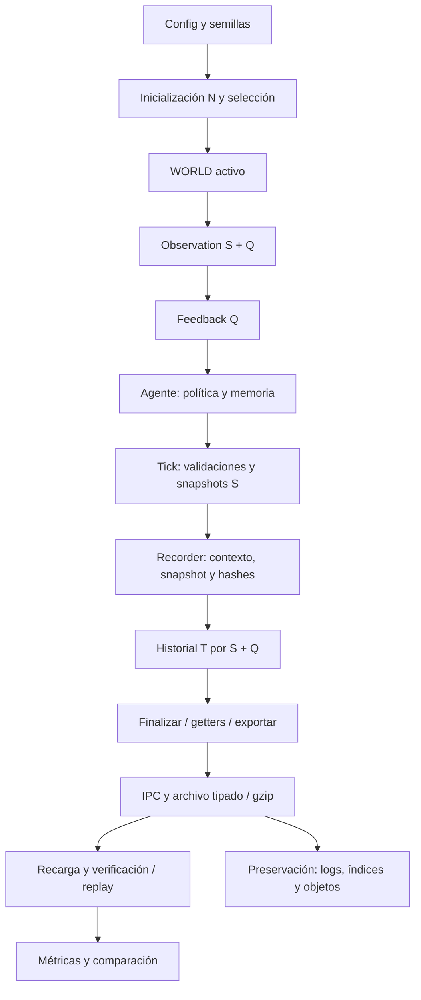

# WL-RC1-A/B — Caracterización inicial de capacidad de investigación

**Entrega A/B preparada para GATE-1; aceptación del propietario pendiente. RC1-C es propuesta; RC1-D no implementada; RC1-E HOLD / NOT_AUTHORIZED.** Fecha: 2026-11-17, America/Guayaquil. Esto inicia una investigación sobre la infraestructura, sin reabrir su construcción ni extender P01.

## Baseline y disciplina de evidencia

Base exacta: `main` **`030ec332c753d85b266492db1dbb6400ba61c18f`**, merge PR #47, que integra el cierre aprobado `d7521a5cc85f7c90452f953e8328d0fa96e90cc1`. Rama nueva: `research/wl-rc1-ab-characterization`. El [cierre operacional](../../CONSTRUCTION_CLOSURE.md) mantiene `CONSTRUCTION_CLOSED_WITHIN_APPROVED_OPERATIONAL_SCOPE`. Las fuentes del análisis se fijan por revisión/SHA-256 en [REVIEW_EVIDENCE.json](REVIEW_EVIDENCE.json); [orden íntegra](order.txt.b64).

La base normativa disponible es v0.2.5 más sustituciones D-01 v0.2.6. MAX_CELLS=2^20, entidad única, BOUNDED y esquemas cerrados no se modifican. F6-N/G00,289BLOCKED y Hitos B/C siguen abiertos. CC-04/CC-05 conservan su estado: caracterizar su coste/alcance no resuelve su admisibilidad contractual.

Se usan seis etiquetas: **SD** deducción estática/matemática bajo supuestos explícitos; **VT-H** prueba verificada históricamente; **EO-H** observación empírica histórica; **H** hipótesis sin comprobar; **RE** recomendación de ingeniería; **DE** propuesta de decisión estratégica. Una cota SD no es una latencia observada. Leer/hash un reporte antiguo no vuelve a ejecutar su prueba; ni profiling ni modelos cambian la norma. No se produjeron benchmarks, episodios, replay o mediciones CPU/RSS nuevos en A/B. Las comprobaciones nuevas son integridad documental, análisis de código y aritmética escalar.

## Hallazgos iniciales

1. **SD, M01–M11.** Una modificación física local no implica una operación pública O(1): validadores de WORLD recorren todo el grid y los snapshots lo materializan. Con S=N+L, la transición confirmada válida tiene coste Θ(S) en el modelo declarado, antes de registro/contexto/agente. Incluso regeneración0 conserva la validación completa. Es candidato a contraste, no autorización de optimización.
2. **SD, M09–M10.** Observation materializa Q=(2r+1)^2 registros, incluidos OUT_OF_BOUNDS, y valida WORLD antes del guard. No basta usar min(Q,N) como coste. El guard usa 64Q+8(2r+1)≤64MiB: r511 pasa esa desigualdad y r512 no. Es una estimación interna, no medición de heap ni garantía de que r511 pueda construirse con memoria disponible. Feedback vuelve a copiar Q.
3. **SD, M12–M17.** El append interno de Recorder evita volver a copiar todo el prefijo: coste por paso O(S+Q) con supuestos de arrays/Map; conserva historial O(T(S+Q)) como cota de tamaño lógico. Finalizar/exportar/getters completos sí recorren ese historial. Consultar `recorder.steps` después de cada paso o usar el helper de replay que exporta cada prefijo puede generar trabajo acumulado Θ(T²(S+Q)); el bucle `replay_trajectory` pide explícitamente no exportarlo por tick.
4. **SD, M18/M20/M24.** El coste de verificación no es solo «leer hashes»: `verifyArtifact` en la ruta COMPLETED realiza cuatro pasadas de T transiciones por su árbol de llamadas normal, además de serializaciones/comparaciones. Hay cargas VM, fuente/Git, compresión, copias IPC y retención de resultados completos en el padre. `verifyProposal` además llama `runtimeIdentity`, que lee y calcula SHA-256 del ejecutable Node completo en cada comprobación: F incluye ese binario, no solo scripts. El timeout del worker no acota todo ese trabajo ni su RAM agregada.
5. **SD, M21–M23.** El contador elemental de consumos es lineal en eventos; `measure` añade posiciones y lectura inicial N. La comparación completa canonicaliza payloads de repeticiones, y el oráculo valida/decodifica archivos: no tienen el coste del contador elemental. La independencia del cálculo no es independencia del motor.
6. **SD, M25–M27.** La preservación deduplica blobs idénticos, pero relee archivos terminados y conserva índices/logs acumulativos. FINISH usa búsqueda `find` desde el inicio: en un log secuencial válido con A intentos, hace A(A+1)/2 inspecciones de intentos. Repetir snapshots mientras A crece puede acumular costes superlineales aunque cada intento sea inmutable. El número de índices y de referencias históricas también importa.
7. **H/EO-H.** En P01 pequeño es plausible que verificaciones/archivo dominen a la decisión del agente. Los tiempos smoke históricos lo sugieren, pero no aíslan componentes ni prueban su causalidad, escalado, efecto de GC o límites de capacidad. No se extrapolan sus medias a nuevos dominios.

El detalle de contratos, entradas, estructuras, bucles, memoria, casos, riesgos y experimentos por función está en el [modelo](COMPLEXITY_MODELS.md) y su [catálogo completo](function-models.json). Las cuatro preguntas y los huecos de medición están en [QUESTIONS_AND_EVIDENCE.md](QUESTIONS_AND_EVIDENCE.md).

## Dependencias y posibles cuellos de botella

Alcance: flujo con agente. Sin agente omite O/F/A y usa WAIT efectivo; no omite validación, snapshots, hashes o historial. La supervisión rodea al worker; archivo/verificación se ejecutan además en el controlador. F6-F corre en proceso separado, pero comparte host/disco y puede perturbarlo. Fuente de aristas: funciones M01–M27; no se infiere un cuello de botella dominante por dibujar el grafo.

Riesgos fundamentados, sin clasificar como nuevos defectos de construcción: (R1) memoria Q y copias repetidas; (R2) historial T×N más contextos; (R3) repetición de pruebas físicas durante verificación; (R4) padre conserva P payloads y varias representaciones a la vez; (R5) logs/índices acumulativos y búsquedas; (R6) JIT/GC/IPC/compresión/I/O pueden dominar constantes; (R7) timeouts censuran muestras y no garantizan techo RSS; (R8) reutilizar el perfil rígido P01 como ejecutor genérico alteraría identidad/guards. R1–R5 tienen mecanismo estático; su importancia cuantitativa queda H.

## Interpretación desde seis perspectivas

| Perspectiva | Conclusión admisible ahora | Lo que requiere evidencia posterior |
|---|---|---|
| Algoritmos/complejidad | Separar N,Q,T,P e índices; demostraciones condicionales y volúmenes de copia | Ajuste empírico, constantes y rango práctico |
| Rendimiento/sistemas | Heap por worker, RSS de proceso y RAM del conjunto son magnitudes distintas | Perfiles CPU/GC, carga del host, picos simultáneos y presión de memoria |
| Metodología/metaciencia | Mantener unidad experimental, protocolo y datos históricos separados; tiempos P01 no son benchmark causal | Piloto calibrado, orden/bloques, censura e incertidumbre |
| Métodos formales/transiciones | Se conserva acción→lifecycle→dinámica→confirmación; más pasadas de validación no cambian por sí mismas la transición | Equivalencia observable de cualquier instrumento futuro; no conformidad universal |
| Arquitectura/evolución | Acoplamiento de archivo a runtime/fuentes/perfil y uso de getters tiene coste potencial explicable | Contratos de integración/medidas de esfuerzo por cambio; no reescritura por preferencia |
| Operaciones/economía I+D | Presupuesto debe incluir verificación, retención y trabajo humano, no solo episodios | Q4 longitudinal: esfuerzo, retrabajo, preparación y reuso en investigaciones distintas |

Son perspectivas analíticas de esta auditoría, no seis revisores independientes ni aval institucional.

## Registro de decisiones y bloqueantes

| ID | Decisión de análisis o propuesta | Evidencia/justificación | Estado |
|---|---|---|---|
| RCA-01 | Fijar baseline de estudio posterior al cierre, sin editar producción ni STATUS | PR47/SHA y diff exclusivamente nuevo expediente | ADOPTED_FOR_ANALYSIS |
| RCA-02 | Modelar cantidad de trabajo y memoria viva alcanzable, separadas de wall/RSS | Semántica de bucles/copias; runtime no especifica GC/latencias | ADOPTED_FOR_ANALYSIS |
| RCA-03 | Separar API incremental de getters/helpers que exportan prefijo | Recorder y replay en revisión fijada | ADOPTED_FOR_ANALYSIS |
| RCA-04 | Evaluar Q4 longitudinalmente; no inferir ahorro I+D a partir de P01 | No hay series comparables de horas/cambios/costes | NOT_ESTABLISHED; no bloquea Q1–Q3 |
| RCA-05 | Proponer piloto escalonado, controles de perturbación y límites; no instrumentar aún | RC1-C propuesta, no autorizada por GATE-1 | PROPOSED_FOR_OWNER_REVIEW |
| RCA-06 | No reutilizar autorización, freeze ID ni seeds finales P01 para RC1 | Investigación distinta; gates propios | ADOPTED_FOR_PREPARATION |

No hay bloqueante para entregar A/B. Hay incertidumbres reales que impiden cotas universales de wall/RSS y valores numéricos de ahorro: GC/JIT, zlib/I/O, distribución PRNG, límites ambientales y Q4. Se mantienen como variables/supuestos, no se rellenan con cifras inventadas. La falta de fuentes históricas bloquea F6-N; no el análisis del código efectivamente publicado.

## Entrega y siguiente puerta

A/B satisface el alcance de preparación: baseline, preguntas, modelos, dependencias, riesgos y fuentes revisadas. **GATE-1 pendiente** de aceptar esas preguntas/modelos. La [propuesta RC1-C](RC1_C_PROPOSAL.md) permite una decisión explícita sobre protocolo/piloto/presupuesto; no es protocolo definitivo aprobado. GATE-2 deberá aprobar versión congelada del protocolo, instrumento validado y presupuesto antes de E definitiva. No se implementaron RC1-D ni RC1-E; F/G no reciben resultados anticipados.

En este incremento no se modifican otros documentos históricos, código, normas, tests o evidencia P01; no se ejecutan sus campañas ni se eliminan originales/transferencia. El expediente conserva hashes y revisión; los resultados de pruebas históricas permanecen históricos. La consulta API puede impedir crear un PR aunque Git permita publicar la rama; se informará el resultado real de publicación.
